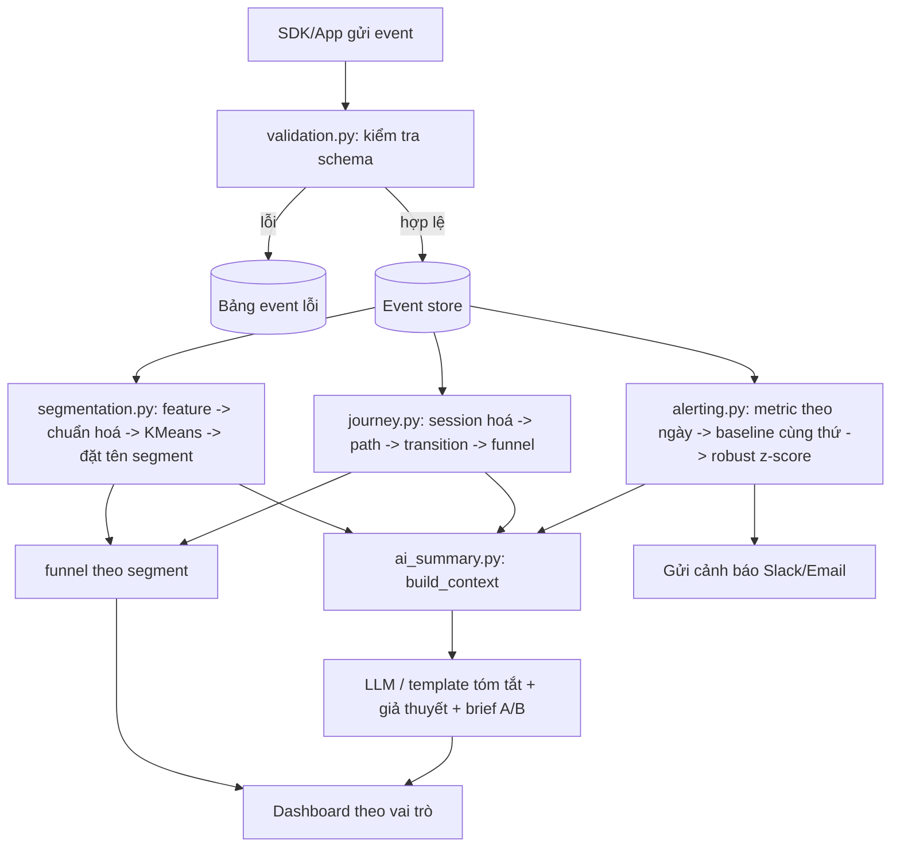
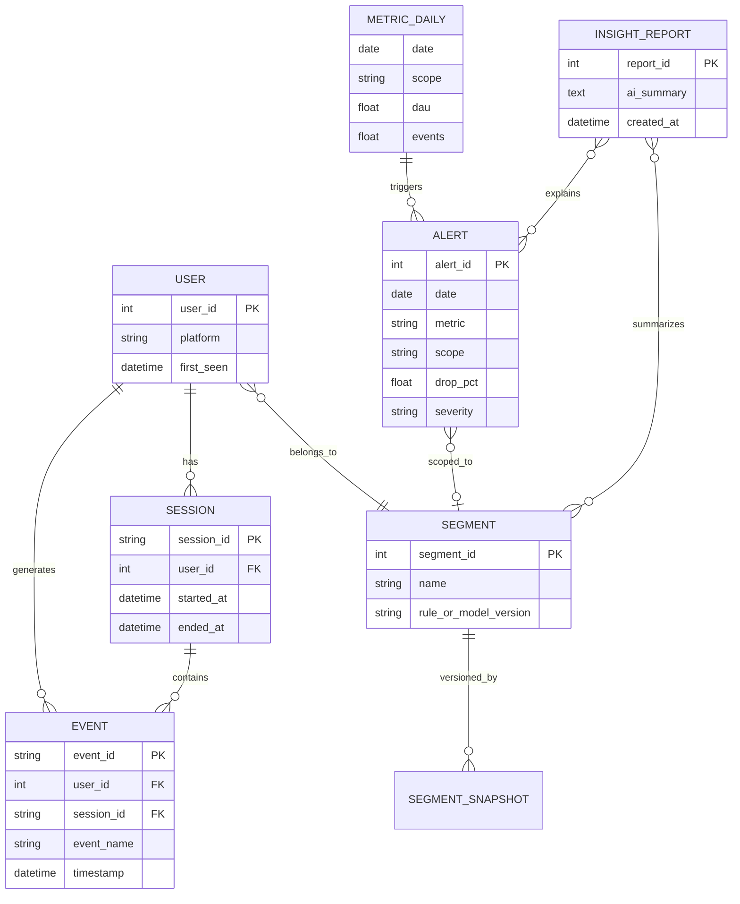

# Product Analytics + AI Summary (phần Segmentation / Journey / Alerting)

## Chạy
    pip install -r requirements.txt
    python main.py            # chạy toàn bộ, in kết quả + lưu output/dashboard.png
    # (tuỳ chọn) AI thật: set ANTHROPIC_API_KEY rồi chạy lại

## Luồng xử lý (activity diagram)

## Mô hình lớp / ERD

